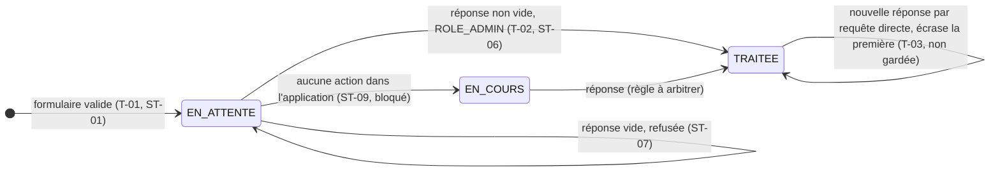

# 5. Transitions d'état, droits et tests exploratoires

## 5.1 Objectif, périmètre et état d'exécution

Cette fiche prépare la semaine 5 à partir des entités, contrôleurs et règles de sécurité du dépôt. Elle décrit le comportement observé dans le code et les scénarios à exécuter. **Les parcours exploratoires ne sont pas déclarés exécutés** : ils nécessitent une application démarrée, des comptes fictifs et une base de test isolée.

Périmètre : cycle de vie des réclamations, lecture par propriétaire, accès administrateur, refus par rôle, et cohérence de la réservation lors des explorations croisées. Ne pas utiliser de données personnelles ni exécuter des scénarios mutatifs sur une base de production.

## 5.2 Diagramme d'états des réclamations

```text
                         réponse non vide, action admin
  [création]       +-----------------------------------------+
      |            |                                         v
      v            |                                  +-------------+
 +------------+    |                                  |   TRAITEE   |
 | EN_ATTENTE |----+                                  +-------------+
 +------------+                                       dateTraitement
      |
      | EN_COURS est déclaré dans le commentaire de l'entité,
      | mais aucune transition d'application vers cet état n'a été trouvée
      v
 +------------+  - - - réponse admin / transition à arbitrer - - -> TRAITEE
 |  EN_COURS  |
 +------------+

Transitions non spécifiées ou sans garde dans le modèle actuel :
  TRAITEE -> EN_ATTENTE ?     EN_ATTENTE -> statut inconnu ?
```

**Légende :** flèche pleine = transition observée dans le flux contrôleur; flèche pointillée = transition mentionnée comme possibilité, mais non implémentée/confirmée. Ce schéma ne transforme pas les ambiguïtés produit en règles approuvées.

### État observé dans le code

- La création d'une réclamation valide initialise explicitement `EN_ATTENTE`.
- Le traitement est protégé par `ROLE_ADMIN`; une réponse non vide est enregistrée, puis le contrôleur fixe `TRAITEE` et `dateTraitement`.
- `EN_COURS` apparaît dans le commentaire de l'entité, mais aucune action qui l'applique n'a été identifiée dans le parcours examiné.
- `Reclamation::setStatut()` accepte une chaîne sans liste autorisée ni contrôle de transition. L'entité ne définit donc pas à elle seule une machine à états.
- Le flux du contrôleur appelle deux fois la mise à jour de `dateTraitement` (via `setStatut('TRAITEE')`, puis `setDateTraitement`). Vérifier que la valeur persistée reste cohérente; ne pas en déduire une anomalie sans reproduction.

### Matrice de transitions à tester

| État initial | Acteur / action | État attendu selon le flux observé | Décision / résultat du test |
|---|---|---|---|
| Aucun | Utilisateur authentifié soumet un formulaire valide | `EN_ATTENTE`; date de création présente; propriétaire = utilisateur connecté | À exécuter (CT-18) |
| `EN_ATTENTE` | Administrateur soumet une réponse non vide | `TRAITEE`; réponse et date de traitement présentes | À exécuter (CT-22) |
| `EN_ATTENTE` | Administrateur soumet une réponse vide | Aucun traitement; flash d'erreur; état inchangé | À exécuter (CT-22, variante) |
| `EN_ATTENTE` | Utilisateur non administrateur appelle l'action admin | Refus d'accès; état inchangé | À exécuter (CT-02/03, EXPL-03) |
| `EN_ATTENTE` | Passage à `EN_COURS` | Aucune action web observée; règle cible à décider | Bloqué produit (CT-23) |
| `TRAITEE` | Deuxième soumission / modification | Garde de transition non visible; comportement cible à décider | À explorer; ne pas présumer un refus |
| Tout état | Statut inconnu transmis directement au setter | Pas de garde observée dans l'entité | Test unitaire de modèle à envisager après décision produit |

## 5.3 Matrice des rôles et propriétaires

| Fonction | Anonyme | Utilisateur authentifié / propriétaire | Autre utilisateur | Conducteur | Administrateur |
|---|---|---|---|---|---|
| Créer une réclamation (`/reclamation/nouvelle`) | Refus par `ROLE_USER` | Autorisé; réclamation rattachée à la session | Chaque compte crée la sienne | Autorisé si `ROLE_USER` (rôle hiérarchique à confirmer) | Autorisé si `ROLE_USER` |
| Liste « mes réclamations » | Refus par `ROLE_USER` | Liste filtrée sur l'utilisateur courant | Ne doit pas voir la liste d'autrui | Même règle utilisateur | La route de liste reste filtrée sur l'utilisateur courant |
| Détail `/reclamation/voir/{id}` | Refus par `ROLE_USER` | Autorisé pour le propriétaire | Refus explicite si non propriétaire | Autorisé seulement si propriétaire | Autorisé par exception dans le contrôleur |
| Liste/traitement admin | Refus | Refus sans `ROLE_ADMIN` | Refus sans `ROLE_ADMIN` | Refus sans `ROLE_ADMIN` | Autorisé; réponse non vide traite la réclamation |
| Réserver / annuler | Refus par `ROLE_PASSAGER` | Passager autorisé pour ses propres actions | Le propriétaire doit être contrôlé à l'annulation | Refus sauf si aussi `ROLE_PASSAGER` | À tester selon la composition réelle de ses rôles |
| Gérer un véhicule | Refus par `ROLE_CONDUCTEUR` | Propriétaire du véhicule autorisé | Un autre propriétaire doit être refusé pour modifier/supprimer | `ROLE_CONDUCTEUR` requis | À tester selon les rôles effectifs |

Les refus attendus ci-dessus sont des critères de test à confirmer avec une session HTTP et la configuration réelle des rôles. `ROLE_USER` est un attribut de contrôleur; vérifier les rôles hérités/attribués aux comptes de fixture.

## 5.4 Scénarios de test associés

| ID | Préconditions | Action | Résultat et preuve attendus |
|---|---|---|---|
| ST-01 | Utilisateur A connecté; formulaire valide | Créer une réclamation | Une seule ligne; `EN_ATTENTE`; propriétaire A; date de création; affichée dans la liste A |
| ST-02 | Message vide puis 9 caractères | Soumettre chaque cas | Formulaire invalide; aucun enregistrement |
| ST-03 | Message de 10 caractères | Soumettre | Accepté si le sujet est une valeur de la liste |
| ST-04 | Réclamation A existante; utilisateur B connecté | Ouvrir le détail par URL directe | Refus d'accès; aucune donnée de A dans la réponse |
| ST-05 | Réclamation A existante; administrateur connecté | Ouvrir son détail puis la liste admin | Consultation permise |
| ST-06 | Réclamation en attente; administrateur connecté | Répondre avec texte non vide | Réponse persistée; état `TRAITEE`; date de traitement non nulle |
| ST-07 | Réclamation en attente; administrateur connecté | Soumettre une réponse vide | Flash d'erreur; statut et date non modifiés |
| ST-08 | Réclamation en attente; compte sans rôle admin | Appeler directement la route de traitement | Accès refusé; aucune mutation |
| ST-09 | Décision produit sur `EN_COURS` non fournie | Chercher/essayer le passage à `EN_COURS` | Documenter l'absence de transition; cas bloqué, pas de résultat inventé |
| ST-10 | Deux sessions et stock isolé | Réserver dans la première, rafraîchir la seconde; annuler puis répéter | Stock, statut, montant et propriété cohérents; aucun double remboursement de places |

## 5.5 Tests exploratoires — chartes et journal

Chaque session dure environ 30 minutes. Consigner build/SHA, environnement, rôle, données fictives, heure, actions, résultat, preuve anonymisée et anomalie. Un test non exécuté reste **Non exécuté**; une règle produit inconnue reste **Bloqué**.

### Charte EXPL-01 — cycle de réclamation

- **Mission :** parcourir dépôt, suivi et traitement de la réclamation.
- **Compte/données :** utilisateur A, utilisateur B, administrateur; formulaire avec sujet de liste et message de 10 caractères.
- **Variations :** message vide/9/10 caractères; champ trajet optionnel; réponse admin vide/non vide; rafraîchissement et retour navigateur.
- **Observer :** doublons, statut, dates, propriétaire, flashs, persistance après rechargement.
- **Arrêt :** fuite d'une réclamation d'autrui ou mutation inattendue; préserver la preuve et l'état.

### Charte EXPL-02 — rôles et accès directs

- **Mission :** essayer les liens puis les URL directes avec session anonyme, passager A/B, conducteur et admin.
- **Cibles :** créer/lister/voir une réclamation; ouvrir les pages admin; annuler une réservation d'autrui.
- **Observer :** statut HTTP/redirection, contenu de la page, mutation éventuelle, différence navigation vs accès direct.
- **Résultat attendu :** refus sans révéler de données privées; seul le propriétaire ou l'admin autorisé voit le détail.

### Charte EXPL-03 — cohérence réservation/annulation

- **Mission :** suivre le stock avant/après une réservation, une annulation et une répétition.
- **Variations :** 1, nombre disponible, 0, négatif, supérieur au stock; départ à plus/moins de deux heures.
- **Observer :** UI et JSON si les deux chemins sont disponibles; prix, statut, date, stock après relecture.
- **Précaution :** données isolées; aucune concurrence destructive sur un environnement partagé.

### Charte EXPL-04 — navigation et robustesse

- **Mission :** session expirée, retour navigateur, double clic, requête répétée et formulaire partiellement rempli.
- **Observer :** doublons, erreurs non maîtrisées, messages, fuite d'informations et état final.
- **Clôture :** noter les limites de l'exploration; ne pas conclure à l'accessibilité ou à la performance sans campagne dédiée.

### Fiche de journal à remplir

| Champ | Valeur |
|---|---|
| Session / date / exécutant | À renseigner |
| Version / SHA / environnement | À renseigner |
| Charte / mission | EXPL-01 à EXPL-04 |
| Rôle et jeu de données fictif | À renseigner |
| Actions exactes et résultat attendu | À renseigner |
| Résultat observé / Réussi-Échoué-Bloqué-Non exécuté | À renseigner |
| Preuve anonymisée / anomalie liée | À renseigner |

## 5.6 Premières fiches d'observation/anomalie

Les observations ci-dessous sont issues d'une lecture statique. **Aucune n'est confirmée en exécution**. L'impact et la sévérité restent à évaluer avec une règle métier approuvée.

### OBS-05-01 — Transition directe vers `TRAITEE`

- **Préconditions :** réclamation `EN_ATTENTE`; session administrateur; base de test.
- **Étapes :** ouvrir la liste admin; saisir une réponse non vide; soumettre; relire l'état et la date.
- **Attendu :** dépend de la décision produit : soit traitement direct autorisé, soit passage intermédiaire `EN_COURS` requis.
- **Observation statique :** le contrôleur admin passe directement à `TRAITEE`; aucun flux `EN_COURS` n'a été trouvé dans le parcours examiné.
- **État :** ambiguïté à arbitrer / reproduction à exécuter; pas un défaut confirmé.
- **Priorité / sévérité :** non attribuées.

### OBS-05-02 — Transition de statut non gardée dans l'entité

- **Préconditions :** instance de réclamation en mémoire.
- **Étapes :** appeler `setStatut()` avec `EN_COURS`, `TRAITEE`, puis une chaîne non prévue; vérifier statut/date.
- **Attendu :** à définir si l'entité doit n'accepter que les transitions autorisées.
- **Observation statique :** le setter accepte une chaîne sans liste de choix ni validation de transition; `dateTraitement` est renseignée pour `TRAITEE`.
- **État :** constat de code, effet métier et reproductibilité à tester; pas un défaut confirmé.
- **Priorité / sévérité :** non attribuées.

### OBS-05-03 — Réponse et date de traitement modifiées par deux appels

- **Préconditions :** réclamation en attente; administrateur; horloge de test documentée.
- **Étapes :** traiter avec réponse non vide; relire la date enregistrée et le statut.
- **Attendu :** date de traitement renseignée une seule fois et cohérente avec l'événement.
- **Observation statique :** le contrôleur appelle `setStatut('TRAITEE')`, qui renseigne déjà la date, puis appelle `setDateTraitement()` immédiatement après.
- **État :** à reproduire; deux valeurs très rapprochées ne prouvent pas à elles seules une défaillance.
- **Priorité / sévérité :** non attribuées.

### OBS-05-04 — Comptage des réclamations en cours non explicite

- **Préconditions :** existence éventuelle d'une réclamation en `EN_COURS`.
- **Étapes :** comparer le statut stocké aux statistiques de la liste utilisateur et au tableau admin.
- **Attendu :** à définir si `EN_COURS` devient un état utilisé.
- **Observation statique :** les statistiques de la liste comptent `EN_ATTENTE` et `TRAITEE`, sans compteur explicite `EN_COURS`.
- **État :** dépend de la décision sur ce statut; pas un défaut confirmé.
- **Priorité / sévérité :** non attribuées.

### Fiche générique à ouvrir après reproduction

```text
ID / titre :
Version (SHA), environnement, date :
Rôle et données anonymisées :
Préconditions :
Étapes exactes :
Résultat attendu (règle approuvée) :
Résultat observé :
Preuve / fréquence :
Impact, sévérité, priorité :
État : À reproduire | Confirmé | Rejeté | Bloqué :
Régression et responsable :
```

## 5.7 Critères de clôture de la semaine 5

- Le responsable métier a tranché si `EN_COURS` est un état exigé et quelles transitions sont légales.
- ST-01 à ST-10 exécutés ou marqués explicitement bloqués/non exécutés avec motif.
- Les contrôles propriétaire/administrateur sont vérifiés par accès direct et par interface.
- Chaque observation est confirmée, rejetée ou conservée comme ambiguïté avec preuve anonymisée.
- Les risques de fuite d'une réclamation et de modification par rôle non autorisé sont réévalués avant la campagne de livraison.

## 5.8 Résultats réellement exécutés le 10 novembre 2026

La suite complète `php bin/phpunit` a réussi : **27 tests, 74 assertions, 0 échec et aucune dépréciation** (PHP 8.4.27, PHPUnit 12.5.23). Sept tests utilisent Symfony WebTestCase et la base de test dédiée; leurs comptes et réclamations de fixture ont été supprimés. Le contrôle SQL a trouvé zéro compte de test résiduel.

| Scénario / contrôle | Résultat observé | Statut |
|---|---|---|
| Création authentifiée d'une réclamation | Formulaire accepté; ligne persistée avec `EN_ATTENTE`, date de création et propriétaire correct | Réussi (HTTP/DB) |
| Message de 9 caractères / message de 10 caractères | 9 rejetés par le formulaire; 10 acceptés dans le scénario de création | Réussi (HTTP/DB) |
| Visiteur anonyme sur réservation, nouvelle réclamation et admin | Les trois routes redirigent vers `/connexion` (HTTP 302) | Réussi pour l'accès anonyme seulement |
| Propriétaire / utilisateur tiers sur le détail | Propriétaire autorisé; autre compte reçoit HTTP 403 sans le message testé dans la réponse | Réussi (HTTP) |
| Liste « mes réclamations » | Seule la réclamation du compte connecté est affichée | Réussi (HTTP) |
| Réponse admin non vide / vide | Texte non vide persiste avec `TRAITEE` et date; réponse vide ne modifie pas l'état | Réussi (HTTP/DB) |
| Non-admin sur administration | Un passager connecté reçoit HTTP 403; traitement réservé au rôle admin | Réussi |
| Transition vers `EN_COURS` | Aucune action observée; statut à arbitrer par le métier | Bloqué produit |
| Tests exploratoires dans un navigateur réel, accessibilité et performance | Parcours manuel et mesures non effectués | Non exécutés |

Les contrôles HTTP ont été exécutés par BrowserKit avec le kernel Symfony; ils ne constituent pas une exploration manuelle dans un navigateur. Les chartes EXPL-01 à EXPL-04 restent à effectuer; aucune des observations OBS-05-01 à OBS-05-04 n'est déclarée confirmée par exécution.

## 5.9 Campagne finale du 11/11/2026 — résultats exécutés

Référentiel : EX-25 (réclamations), EX-19 et EX-32 (réservations), CA-10, CA-12 et CA-13 (PDF de la semaine 3). Toutes les preuves sont dans `preuves/semaine5/` ([README](../../preuves/semaine5/README.md)).

### 5.9.1 Diagrammes d'états vérifiés sur le code et par exécution

```mermaid
stateDiagram-v2
    direction LR
    [*] --> CONFIRMEE : réservation (TC-22 ; voies HTML et JSON)
    CONFIRMEE --> ANNULEE : annulation par le propriétaire, trajet futur (TC-29, ST-10)
    ANNULEE --> ANNULEE : annulation répétée, stock inchangé (CA-10, ST-10)
    CONFIRMEE --> ANNULEE : trajet passé, accepté à tort (ANO-09)
```





Ces diagrammes sont cohérents avec le code : les seuls statuts écrits par l'application sont `EN_ATTENTE`/`TRAITEE` pour les réclamations et `CONFIRMEE`/`ANNULEE` pour les réservations. `EN_COURS` existe dans les données préexistantes de `wassalni_test` (une réclamation observée dans la liste d'administration), mais aucune action ne le produit.

### 5.9.2 Matrice des transitions — résultats

| Transition | Acteur | Attendu | Observé | Statut | Preuve |
|---|---|---|---|---|---|
| ∅ → EN_ATTENTE | Passager | Création, propriétaire = session | Conforme | Réussi | T-01, ST-01 |
| EN_ATTENTE → TRAITEE | Admin, réponse non vide | Réponse et date persistées | Conforme ; date cohérente (OBS-05-03 rejetée) | Réussi | T-02, ST-06 |
| EN_ATTENTE → (refus) | Admin, réponse vide | Aucun changement, message affiché | Aucun changement, **mais aucun message** | Réussi (données) / Échoué (retour) | ST-07, ANO-31 |
| EN_ATTENTE → TRAITEE | Passager (URL directe) | 403 | 403, aucune mutation | Réussi | ST-08, T-06 |
| EN_ATTENTE → EN_COURS | Admin | Règle non définie | Aucune action proposée | **Bloqué** (produit) | ST-09, OBS-05-01 |
| TRAITEE → TRAITEE | Admin (requête directe) | Règle non définie | Réponse écrasée | Constat (caractérisation) | T-03 |
| Statut hors liste | Entité | Règle non définie | Accepté par `setStatut()` | Constat (OBS-05-02) | T-04 |
| CONFIRMEE → ANNULEE | Propriétaire, trajet futur | ANNULEE, places rendues | Conforme | Réussi | TC-29, ST-10 |
| ANNULEE → ANNULEE | Propriétaire | Aucun second remboursement | Stock inchangé (4) | Réussi | CA-10, ST-10 |
| CONFIRMEE → ANNULEE | Autre passager | 403 | 403 | Réussi | CA-13 |
| CONFIRMEE → ANNULEE | Propriétaire, trajet passé | Refus | Accepté | **Échoué** | TC-30, ANO-09 |

### 5.9.3 Matrice des rôles observée (EXPL-02, accès direct par URL)

| URL | Anonyme | Passager | Conducteur | Admin |
|---|---|---|---|---|
| `/admin/reclamations` | → `/connexion` | 403 | 403 | 200 |
| `/admin/utilisateurs` | → `/connexion` | 403 | 403 | 200 |
| `/conducteur/demandes` | → `/connexion` | 403 | 200 | 403 |
| `/vehicule/mes-vehicules` | → `/connexion` | 403 | 200 | 403 |
| `/reservation/mes-reservations` | → `/connexion` | 200 | 403 | 403 |
| `/reclamation/nouvelle` | → `/connexion` | 200 | 200 | 200 |
| `/passager/dashboard` | → `/connexion` | **500** (ANO-34) | 403 | 403 |

Les rôles ne sont pas hiérarchisés : l'administrateur n'hérite pas des droits passager ou conducteur. C'est cohérent avec EX-31, puisque chaque rôle n'accède qu'à ses pages.

### 5.9.4 Scénarios ST-01 à ST-10 (Playwright, Chrome)

**10 scénarios exécutés : 9 réussis, 1 bloqué (ST-09).** Rapport JSON : 10 attendus, 0 inattendu.

| ID | Résultat observé | Statut | Figure |
|---|---|---|---|
| ST-01 | Réclamation `EN_ATTENTE`, propriétaire = passager A (relecture SQL) | Réussi | `S05_ST01_creation_reclamation.png` |
| ST-02 | Message vide bloqué ; 9 caractères refusés avec « au moins 10 caractères » ; aucune ligne créée | Réussi | `S05_ST02_message_9_caracteres_refuse.png` |
| ST-03 | 10 caractères acceptés | Réussi | `S05_ST03_message_10_caracteres_accepte.png` |
| ST-04 | Passager B → HTTP 403, message de A absent de la page | Réussi | `S05_ST04_acces_interdit.png` |
| ST-05 | Admin : détail 200 et carte de la liste visibles | Réussi | `S05_ST05_admin_*.png` |
| ST-06 | `TRAITEE`, réponse et date persistées ; le passager voit la réponse | Réussi | `S05_ST06_*.png` |
| ST-07 | Statut et date inchangés ; message d'erreur non affiché (ANO-31) | Réussi (données) | `S05_ST07_reponse_vide_refusee.png` |
| ST-08 | Passager sur la route de traitement → 403, aucune mutation | Réussi | `S05_ST08_traitement_par_non_admin_403.png` |
| ST-09 | Seule action proposée : « Répondre et traiter » | **Bloqué** (règle produit) | `S05_ST09_absence_action_en_cours.png` |
| ST-10 | Stock 4 → 3 (A réserve) ; B voit 3 ; annulation → 4 ; annulation répétée → 4 | Réussi | `S05_ST10_1` à `S05_ST10_4` |

### 5.9.5 Sessions exploratoires (EXPL-01 à EXPL-04)

**Nature des sessions.** Elles ont été **conduites par l'assistant de test à l'aide de Playwright** : les sondes ont été choisies au fil des observations, puis rejouées pour produire les preuves. Ce ne sont **pas** des explorations manuelles réalisées par un humain. Une session manuelle de 30 minutes par charte reste recommandée ; la fiche de journal du §5.5 est prête à cet usage.

| Charte | Sonde | Observation | Conclusion |
|---|---|---|---|
| EXPL-01 | Rafraîchir puis revenir en arrière après l'envoi d'une réclamation | 1 seule réclamation enregistrée | Conforme (modèle POST-redirection-GET) |
| EXPL-02 | Accès direct à 7 URL pour 4 profils | Matrice §5.9.3 ; **HTTP 500 sur `/passager/dashboard`** | Nouvelle anomalie ANO-34 |
| EXPL-03 | 6 clics sur « + » dans la fenêtre de réservation (3 places disponibles) | Quantité plafonnée à 3 ; total 75 DT | Conforme côté interface (le serveur reste à corriger : ANO-07) |
| EXPL-04 | Double clic sur « Confirmer la réservation » | 1 seule requête et 1 réservation confirmée | Conforme |
| EXPL-04 | Envoi d'un formulaire après effacement des cookies | Redirection vers `/connexion`, aucune donnée créée | Conforme |

### 5.9.6 Devenir des observations OBS-05

| Observation | Conclusion après exécution |
|---|---|
| OBS-05-01 | Confirmée : passage direct à `TRAITEE`. **Bloquée** en attente de la décision produit sur `EN_COURS` (non comptée comme défaut). |
| OBS-05-02 | Confirmée par caractérisation (T-04) : aucune garde dans l'entité. Sans effet visible tant que seul le contrôleur écrit le statut. |
| OBS-05-03 | **Rejetée** : la date de traitement persistée est cohérente avec l'instant de la requête (T-02). |
| OBS-05-04 | **Confirmée** : avec une réclamation `EN_COURS`, la liste affiche total 1, en attente 0, traitées 0 (ANO-33). |

### 5.9.7 Vérification du rapport historique

Le rapport du 10/11/2026 (« 27 tests, 74 assertions, 0 échec, 0 dépréciation ») a été réexécuté sur le même périmètre le 11/11/2026 : **résultat identique**. Il est conservé tel quel dans le §5.8 pour son contexte historique.
