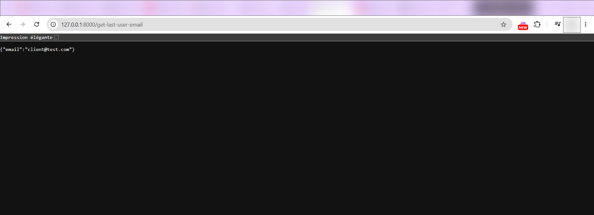
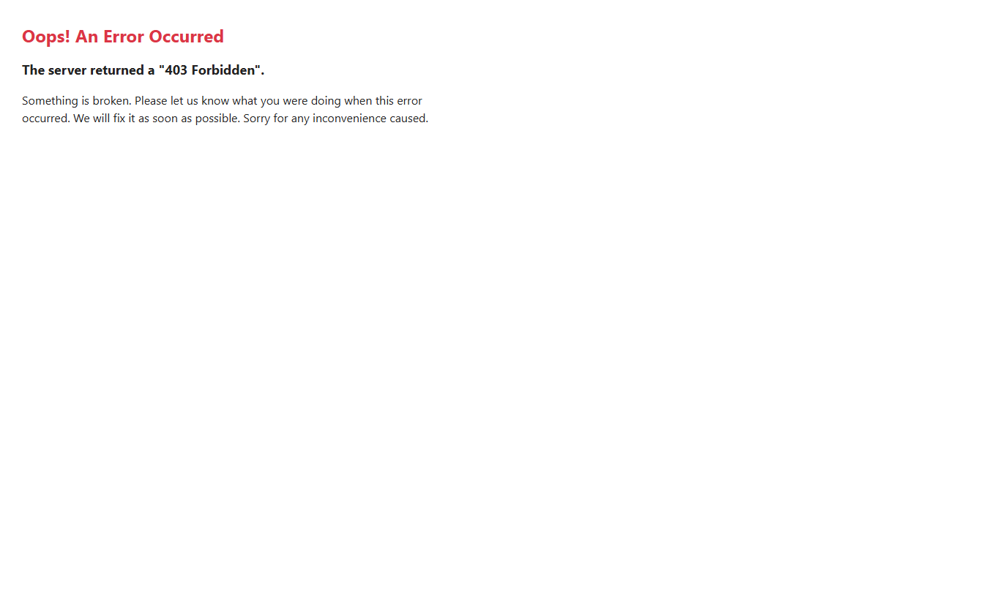
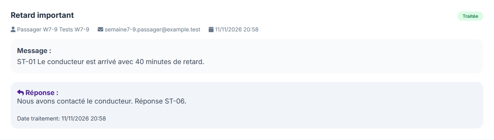
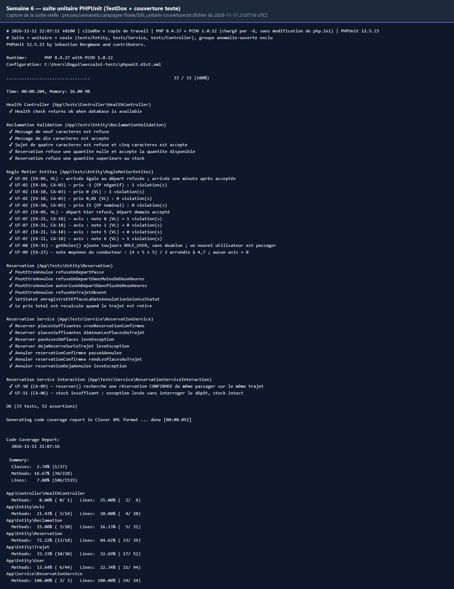
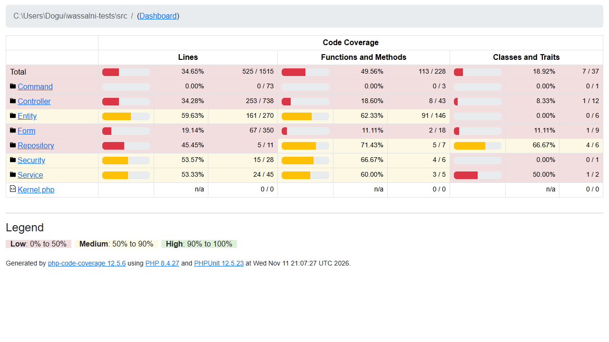
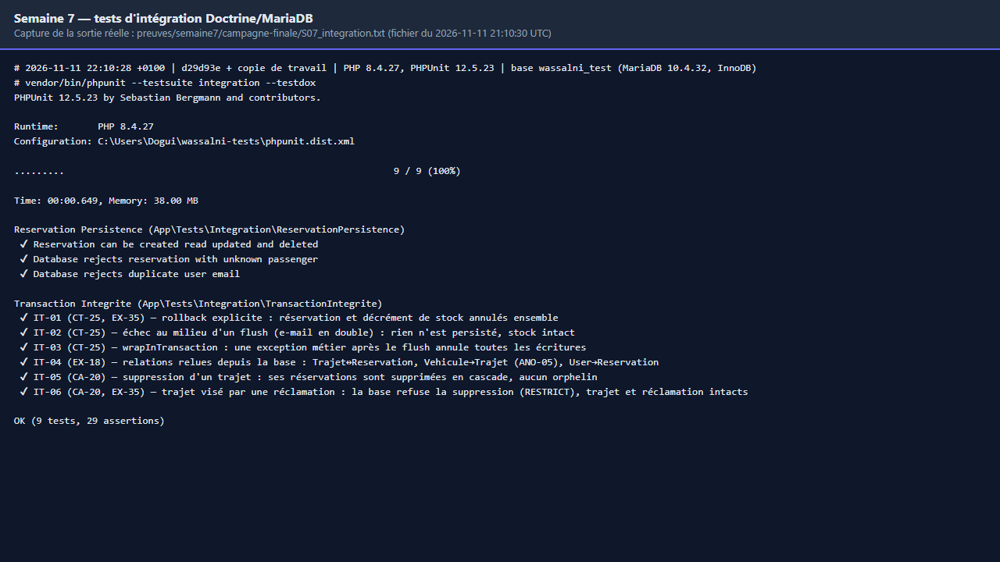
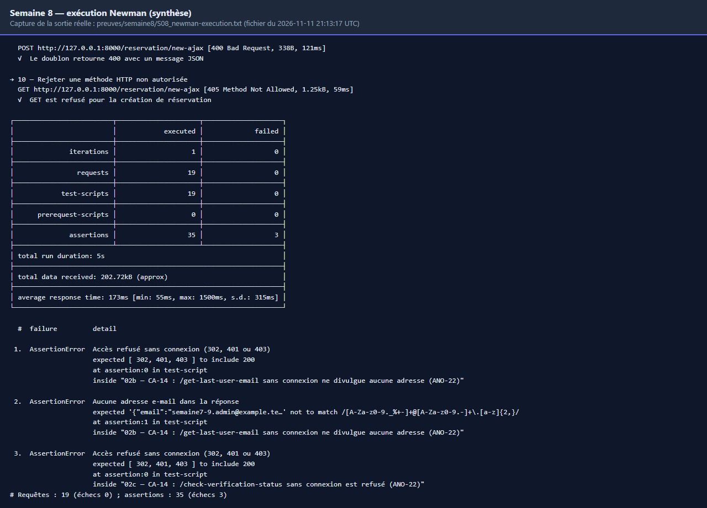
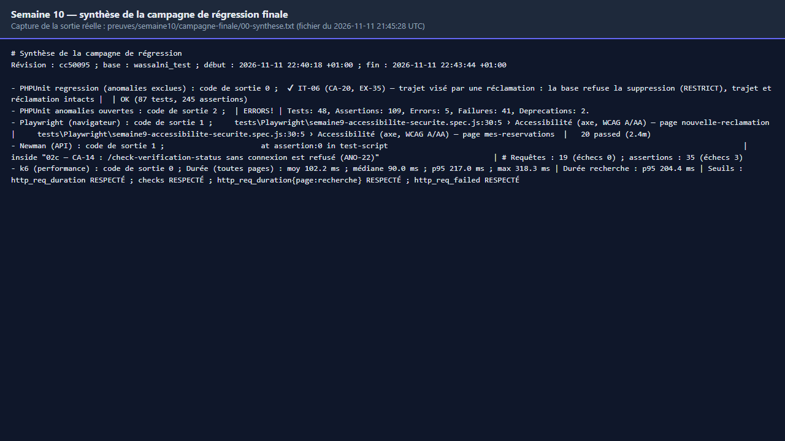
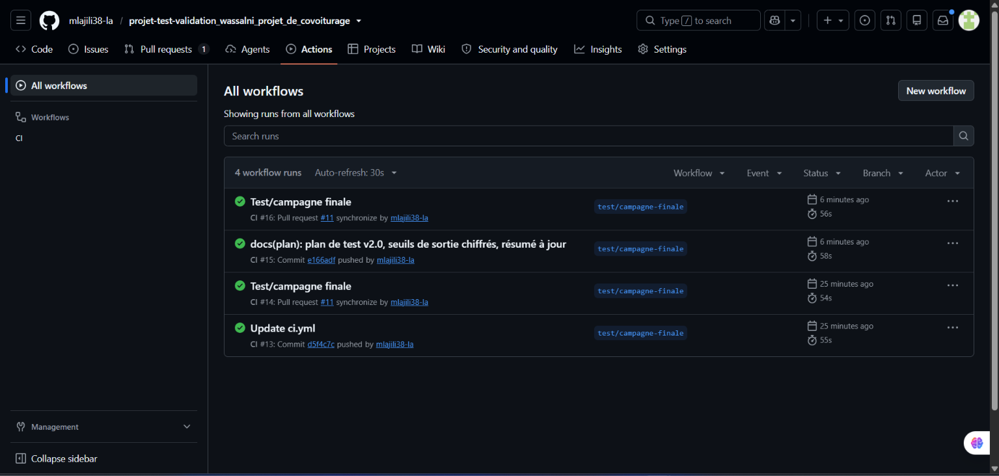

# Rapport final — Test et validation de l'application WASSALNI

**Mini-projet Licence 3 TI, DSI — Atelier Test et validation des logiciels**
Étudiant : Mohamed Lajili · Dépôt : `projet-test-validation_wassalni_projet_de_covoiturage`, branches `test/campagne-finale` et `fix/anomalies-s2` · Version du dossier 2.0 · 21 novembre 2026 (version 1.0.0 du 11 novembre 2026)

---

## Résumé

WASSALNI est une application Symfony 7.4 de covoiturage avec trois rôles : passager, conducteur et administrateur. La campagne a été menée sur dix semaines, sur une base dédiée `wassalni_test` ; la base principale n'a jamais été utilisée.

**Campagne finale du 11/11/2026 (révision `cc50095`).** 87 tests de régression réussis ; 48 tests démontrant 32 anomalies, dont 8 majeures (S2) ; Playwright 20/23 ; Newman 32/35 assertions ; k6 conforme ; couverture 34,65 % des lignes. **Décision : refus de livraison (NO-GO).**

**Corrections et rejeu du 21/11/2026 (révision `72cff37`).** Les 8 anomalies S2 ont été corrigées sur la branche `fix/anomalies-s2`, puis toute la campagne a été rejouée :

- **110 tests de régression** PHPUnit, tous réussis (291 assertions) ;
- **27 tests démontrant les 24 anomalies encore ouvertes** (16 S3, 8 S4, aucune S2, aucune P1) ;
- **23 tests navigateur** Playwright (20 réussis ; les 3 échecs sont l'accessibilité, ANO-36) ;
- **19 requêtes API** Newman, **35 assertions sur 35** réussies ;
- **un test de charge** k6, dont les seuils sont respectés ;
- **couverture : 41,33 % des lignes**, et entre 85,7 % et 100 % sur les classes critiques.

Sur les 35 exigences, 15 sont satisfaites, 10 partiellement, 7 non satisfaites, et 3 n'ont pas été exécutées.

**Décision en vigueur : validation conditionnelle.** Aucun défaut S1 ou S2 n'est ouvert et tous les seuils du plan sont atteints, sauf l'accessibilité. Les conditions de livraison sont détaillées au §8.

| Semaine | Livrable | Document |
|---|---|---|
| 1 | Cadrage, risques R1–R21 | `docs/semaine1-fiche-risques.pdf`, [01](../dossier-tests/01-cadrage-risques.md), [référentiel 00](../dossier-tests/00-referentiel-correspondances.md) |
| 2 | Stratégie et plan de test | `docs/semaine2-plan-de-test.pdf`, [02](../dossier-tests/02-strategie-calendrier.md) |
| 3 | Exigences EX-01–35, critères CA-01–22, traçabilité | PDF semaine 3, [09 matrice finale](../dossier-tests/09-matrice-tracabilite.md) |
| 4 | Cas TC (version officielle : PDF `docs/`), données | PDF semaine 4, [04](../dossier-tests/04-cas-de-test-donnees.md), [correspondance CT→TC](../dossier-tests/00-referentiel-correspondances.md) |
| 5 | États, transitions, droits, exploration | [05 §5.9](../dossier-tests/05-etats-exploration-anomalies.md) |
| 6 | Tests unitaires, couverture | [06 §6.7](../dossier-tests/06-automatisation-bilan.md) |
| 7 | Intégration et base de données | [10](../dossier-tests/10-semaine7-integration.md) |
| 8 | API | [11](../dossier-tests/11-semaine8-api.md) |
| 9 | Interface et non fonctionnel | [12](../dossier-tests/12-semaine9-interface-non-fonctionnel.md) |
| 10 | Régression, anomalies, décision | [14](../dossier-tests/14-semaine10-bilan-decision.md), [07 registre](../dossier-tests/07-registre-anomalies.md), [13 recommandations](../dossier-tests/13-plan-corrections.md) |
| 21/11 | Corrections S2, rejeu, nouvelle décision | [14 §14.7](../dossier-tests/14-semaine10-bilan-decision.md), [07 §7.7](../dossier-tests/07-registre-anomalies.md), [15 écarts avec l'énoncé](../dossier-tests/15-ecarts-enonce.md) |

---

## 1. Semaines 1 à 4 — Cadrage, stratégie, exigences, conception

Les risques **R1 à R21** (probabilité × impact) ont orienté les priorités. Les plus élevés sont R4 (modération contournée), R15 (intégrité), R21 (fuite d'e-mail), R1 (surréservation), R5 (comptes bloqués), R17 (trajets passés) et R20 (actions par GET). La stratégie combine plusieurs niveaux : unitaire (PHPUnit), intégration (Doctrine et MariaDB), système HTTP (BrowserKit), API (Newman), interface (Playwright) et non fonctionnel (axe, k6).

Les 35 exigences et 22 critères d'acceptation ont été déclinés en **28 cas TC** à l'aide des partitions d'équivalence, des valeurs limites et de trois tables de décision (réservation, connexion, visibilité d'un trajet). Le PDF officiel de la semaine 4 ne les présentait que comme des prévisions ; **ils ont tous été automatisés et exécutés**.



**Figure 1** — Essai exploratoire de la semaine 1 (copie anonymisée) : `/get-last-user-email` renvoie une adresse sans connexion. *Scénario* : TC-45. *Résultat observé* : e-mail divulgué. *Interprétation* : écart A-02, confirmé ensuite automatiquement (ANO-22, S2).

## 2. Semaine 5 — Transitions d'état, droits et exploration

Les diagrammes d'états (réclamation et réservation) ont été vérifiés sur le code, puis par exécution. Les scénarios **ST-01 à ST-10** ont été joués dans Chrome. ST-09 est conforme à la règle validée le 11/11 (traitement direct accepté). Quatre sessions exploratoires outillées complètent ces scénarios.


**Figure 2** — ST-01 : création d'une réclamation par le passager A. *Résultat observé* : statut « En attente », propriétaire correct (relecture SQL). *Interprétation* : EX-24 satisfaite.



**Figure 3** — ST-04 : le passager B ouvre la réclamation de A par URL directe. *Résultat observé* : HTTP 403, aucune donnée révélée. *Interprétation* : EX-32 satisfaite pour les réclamations.



**Figure 4** — ST-06 : réponse de l'administrateur. *Résultat observé* : `TRAITEE`, réponse et date persistées. *Interprétation* : transition conforme. L'heure affichée est en UTC (ANO-32).


**Figure 5** — ST-10 : deux sessions. Après la réservation de A, la session B voit 3 places. L'annulation rend la place, et une seconde annulation ne la rend pas deux fois. *Interprétation* : cohérence du stock en usage séquentiel.

**Découverte de l'exploration :** `/passager/dashboard` renvoie une erreur 500 (ANO-34).

## 3. Semaine 6 — Tests unitaires

La suite unitaire compte **33 tests, en Arrange – Act – Assert** : valeurs limites des prix, des places, des notes et des dates ; un stub pour les tests du service ; un mock justifié par la vérification d'une interaction. Les tests unitaires ont révélé **ANO-35** : une contrainte `Range` mal paramétrée fait planter le formulaire de véhicule, ce qui a été confirmé ensuite au niveau HTTP.



**Figure 6** — Sortie réelle de la suite `unitaire` : 33 tests, 52 assertions, OK.



**Figure 7** — Rapport de couverture PCOV (régression complète) : 34,65 % des lignes. *Interprétation* : la logique est dans les contrôleurs, d'où une couverture unitaire faible (7 %). Couvrir une ligne ne garantit pas son exactitude : `ReservationController` est couvert à 84,5 %, mais compte 5 anomalies.

## 4. Semaine 7 — Intégration et base de données

**9 tests d'intégration** : CRUD, clés étrangères, unicité, rollback explicite, atomicité d'un `flush` en échec, `wrapInTransaction`, relations et cascade. **45 tests HTTP/BDD** de régression relisent l'état en base. L'isolation a été vérifiée : les données préexistantes sont identiques avant et après, sans aucun résidu.



**Figure 8** — Sortie réelle des tests d'intégration : 9 tests, 29 assertions, OK. *Interprétation* : la base garantit l'intégrité. Les erreurs 500 d'administration (ANO-23) viennent de l'absence de gestion de ces refus dans l'application.

## 5. Semaine 8 — API

L'application n'expose **aucune API REST** : il y a 4 routes JSON, et aucune n'a été inventée. La collection Postman (19 requêtes, 35 assertions) est exécutée par Newman via un lanceur qui masque le secret et les cookies.



**Figure 9** — Synthèse Newman : 32 assertions réussies, 3 échecs (ANO-22). La voie JSON de réservation est bien protégée : quantités, doublon, JSON invalide, 404 et 405 sont conformes.

## 6. Semaine 9 — Interface et non fonctionnel


**Figure 10** — Parcours critique dans Chrome : connexion, recherche, réservation de 2 places et confirmation. Il est vérifié jusqu'en base : 50 DT, stock 4 → 2. *Résultat* : réussi.


**Figure 11** — Page auditée par axe-core. *Résultat observé* : 2 règles critiques en défaut (`select-name`, `label`) et des contrastes insuffisants. *Interprétation* : ANO-36 et ANO-37. Aucune conformité WCAG n'est revendiquée.

- **Performance (k6, 5 VU, 30 s) :** 0 % d'échec, p95 de 217 ms. Mesure faite sur un serveur de développement mono-processus.
- **Concurrence :** deux transactions entrelacées produisent **2 réservations pour 1 place** (ANO-38, corrigée le 21/11, voir §8).
- **Sécurité élémentaire :** `composer audit` est propre, le cookie est `HttpOnly`/`SameSite`, la page d'erreur ne divulgue rien. Les en-têtes de protection sont absents (REC-01).

## 7. Semaine 10 — Régression et décision



**Figure 12** — Synthèse réelle de la campagne de régression finale (`scripts/run-regression.ps1`, révision `cc50095`).

| Résultat final | Valeur |
|---|---|
| Régression PHPUnit | 87 / 87 réussis (245 assertions) |
| Anomalies démontrées | 48 tests en échec attendu, 32 anomalies ouvertes (8 S2, 16 S3, 8 S4) |
| Playwright | 20 réussis, 3 échoués (ANO-36) |
| Newman | 32 / 35 assertions (3 = ANO-22) |
| k6 | Seuils respectés |
| Exigences | 9 réussies, 9 partielles, 14 échouées, 3 non exécutées |

**Décision du 11/11 : NO-GO (refus de livraison).** Les critères de sortie ne sont pas atteints : 8 anomalies S2 sont ouvertes, et le stock comme le prix peuvent être manipulés. Les conditions d'un GO et les corrections recommandées figurent dans les documents [14](../dossier-tests/14-semaine10-bilan-decision.md) et [13](../dossier-tests/13-plan-corrections.md).

## 8. Corrections des anomalies S2 et rejeu (21/11/2026)

Les corrections ont été faites sur la branche `fix/anomalies-s2`. Pour chaque anomalie, le test qui la démontrait est sorti du groupe `anomalie-ouverte` et fait désormais partie de la régression.

| Anomalie | Correction |
|---|---|
| ANO-07 | Le nombre de places de la voie HTML est validé (entier ≥ 1), comme la voie JSON |
| ANO-20, ANO-21 | Un `UserChecker` refuse la connexion d'un compte non vérifié ou bloqué |
| ANO-22 | Les routes de suivi d'inscription ne répondent que pour la session en cours |
| ANO-35 | Paramètre de la contrainte `Range` corrigé : l'ajout de véhicule fonctionne |
| ANO-12, ANO-13 | Toutes les actions qui modifient des données exigent un POST et un jeton CSRF propre à l'action |
| ANO-38 | Décrément du stock par une requête SQL conditionnelle atomique, dans la même transaction que la réservation |

Avant ces corrections, l'intégration continue a été réparée : ses 12 exécutions précédentes échouaient toutes, faute de fichier `.env` dans le dépôt.



**Figure 13** — Intégration continue GitHub Actions verte après réparation du workflow. *Interprétation* : la régression PHPUnit est rejouée automatiquement à chaque push, sur une base MariaDB neuve.

**Un incident instructif.** Le premier commit de la correction d'ANO-38 ne contenait pas le contrôleur modifié, et le rejeu était pourtant vert : le test IT-07 vérifiait l'atomicité du service, pas son utilisation par le contrôleur. Un test garde-fou a été ajouté ; il échoue sur la révision incomplète et passe sur la révision corrigée. Un test réussi ne prouve que ce qu'il vise réellement.

| Résultat | 11/11 (`cc50095`) | 21/11 (`72cff37`) |
|---|---|---|
| Régression PHPUnit | 87 / 87 | **110 / 110** |
| Anomalies ouvertes | 32 (8 S2) | **24 (0 S2)** |
| Newman | 32 / 35 | **35 / 35** |
| Playwright | 20 / 23 | 20 / 23 (ANO-36) |
| Couverture des lignes | 34,65 % | **41,33 %** |
| Exigences réussies / partielles / échouées / non exécutées | 9 / 9 / 14 / 3 | **15 / 10 / 7 / 3** |

**Décision du 21/11 : validation conditionnelle.** Tous les seuils du plan de test (§2.7.2) sont atteints, sauf l'accessibilité (ANO-36). Conditions de livraison :

1. avant la mise en production, corriger les anomalies S3 qui touchent l'intégrité métier (ANO-08, 09, 10, 11, 15, 16, 17) et les erreurs 500 connues (ANO-23, 25, 34) ;
2. dans le mois suivant, corriger l'accessibilité (ANO-36) puis les autres anomalies S3/S4 ;
3. après chaque correction, rejouer la campagne complète et garder la CI verte.

Le détail figure dans le document [14, §14.7](../dossier-tests/14-semaine10-bilan-decision.md).

## 9. Limites de la campagne

- Les explorations ont été conduites avec un outil et non manuellement.
- L'inscription et les e-mails n'ont pas été exécutés.
- La concurrence a été démontrée par simulation déterministe, car `php -S` est mono-processus sous Windows.
- La performance a été mesurée sur un serveur de développement.
- L'accessibilité repose sur un audit automatique partiel.
- Seules les 8 anomalies S2 ont été corrigées ; 24 anomalies S3/S4 restent ouvertes et sont rejouées à chaque régression.
- Le référentiel de l'énoncé (RéclaGest) diffère de WASSALNI : affectation, historique, priorité et API REST n'existent pas et n'ont pas été testés ([15](../dossier-tests/15-ecarts-enonce.md)).

## 10. Reproduire

```powershell
composer install ; npm ci
# Définir WASSALNI_TEST_PASSWORD dans .env.test.local (non versionné), base MariaDB wassalni_test migrée
Remove-Item -Recurse -Force var\cache\test
powershell -NoProfile -ExecutionPolicy Bypass -File scripts/run-regression.ps1 -Sortie preuves/semaine10/<nouveau-dossier>
```

La régression PHPUnit est aussi rejouée automatiquement par GitHub Actions (`.github/workflows/ci.yml`) à chaque push.

Les preuves sont indexées dans [`docs/rapport-preuves/index-preuves.md`](../rapport-preuves/index-preuves.md).
